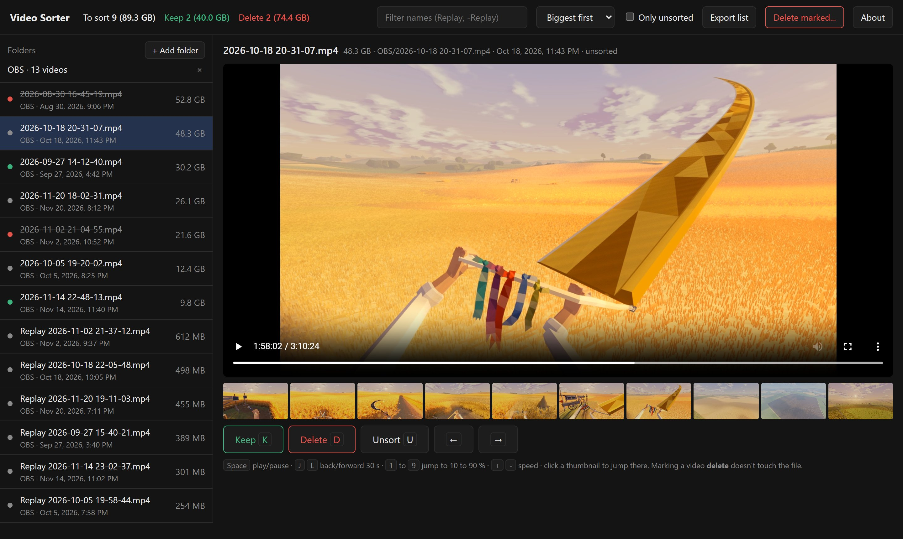
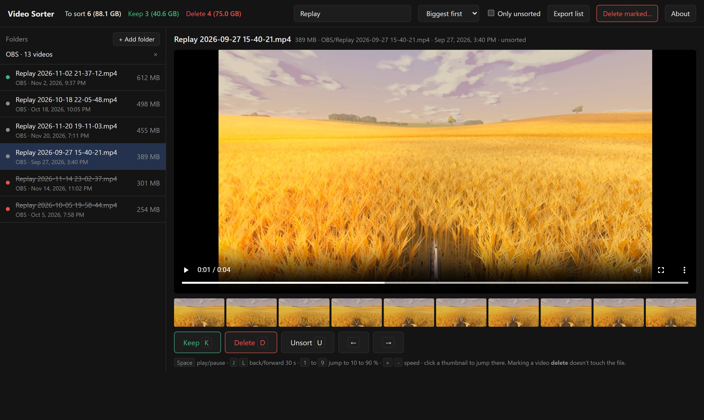

# Video Sorter

A web page to go through a folder of recordings and decide, one by one, what to keep and what to delete.

I wrote it after finding more than 500 GB of old OBS recordings on my drives. It lists them biggest first,
plays each one with a strip of thumbnails so you can see what's in it without watching it all, and you
keep or delete with one key.

**Use it here: https://nabil080.github.io/video-sorter/**



## How it works

Pick a folder (subfolders are included). The biggest unsorted video opens. Skim it, press `K` to keep it
or `D` to mark it for deletion, and the next one opens.

Marking doesn't touch the files. When you're done, **Delete marked...** deletes them for real, after you
confirm and the browser asks for permission. They don't go to the Recycle Bin.

Your choices are saved in the browser, so you can stop halfway and come back later.

| Key | Does |
| --- | --- |
| `K` | keep |
| `D` | mark for deletion |
| `U` | back to unsorted |
| `←` `→` | previous / next video |
| `Space` | play / pause |
| `J` `L` | back / forward 30 seconds |
| `1` to `9` | jump to 10 % ... 90 % |
| `+` `-` | faster / slower |

The filter box takes words to look for in file names, and words starting with `-` to hide.
For example `-Replay` hides the clips saved by the OBS replay buffer, whose names start with "Replay" by default.



## Your videos stay on your computer

Nothing is uploaded. The browser reads the files straight from your disk, and the page's Content Security
Policy has `connect-src 'none'`, which means it can't make any network request at all. No analytics, no
cookies, nothing loaded from another site.

## Browsers

Chrome and Edge get everything, through the
[File System Access API](https://developer.mozilla.org/en-US/docs/Web/API/File_System_API).

Firefox and Safari don't have that API, so there it's read-only: you can watch and mark your videos, then
**Export list** gives you a text file with the paths to delete by hand. You also have to pick the folder
again on each visit.

Playback is whatever your browser can decode. H.264 MP4 works everywhere; HEVC, AV1 or MKV depend on the
browser and your hardware.

## Running it yourself

There's no build step and no dependencies, it's plain HTML, CSS and JavaScript. ES modules don't load from
`file://`, so serve the folder with any static server:

```
python -m http.server
```

then open http://localhost:8000.

- `js/app.js`: the interface
- `js/library.js`: reading folders and deleting files
- `js/thumbnails.js`: thumbnails, taken from a hidden `<video>` drawn on a canvas
- `js/store.js`: saving to IndexedDB

The footage in the screenshots comes from a game I'm making in Godot. The file names, sizes and
durations were made up for the screenshots.
